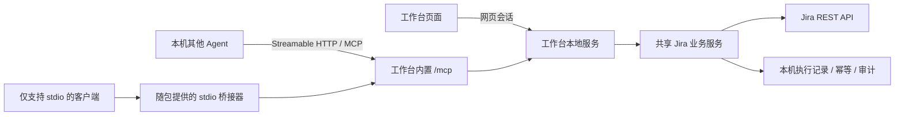

# 本地 Jira MCP 与每日工作记录自动完成设计

状态：首版已在本地实现并使用模拟 Jira 验证，尚未连接真实 Jira 验证工作流、提交或发布。本文保留完整设计，实际使用与首版范围以 README 和 docs/local-mcp.md 为准。

## 1. 目标和主要体验

用户授权其他 Agent 将已完成工作记录写入 Jira。Agent 一次提交当天记录，由本地服务创建需求、编码任务或其他任务、关联父需求、填写工时字段、按允许的路线流转、补充备注和附件，返回逐条结果。也支持操作已有问题。

主要入口为 `jira_submit_daily`。用户可以预先在工作台授权具体 Agent、项目及自动完成路线；范围内的操作直接执行，不要求每条弹窗确认。授权范围外返回结构化拒绝原因，由调用方补充信息或用户调整配置。

“工作已完成”来自调用方明确提供的 `completion: "complete"`，不能因为有工时就推断完成。未完成记录仍可创建并保留当前状态，后续通过 `jira_complete_issue` 继续。

## 2. 本地架构



根据用户要求，MCP 是 Jira 工作台项目内置功能，由同一个本地服务托管并由页面管理启停，不单独部署。主要传输采用 Streamable HTTP；桌面模式示例地址 `http://127.0.0.1:18787/mcp`，开发模式跟随实际端口。不新增默认对外监听，不修改工作台现有回环绑定。

仅支持 stdio 的客户端使用随发行包提供的桥接器，桥接器只转接协议，不持有另一套 Jira 登录或业务状态。客户端连接配置由工作台按实际服务地址、发行路径和客户端格式生成。HTTP 与 stdio 都使用官方 MCP SDK；实现前确认 SDK、协议版本及目标客户端兼容性。

- Agent Token 由用户在工作台创建，绑定明确的 Jira 身份和项目/工具权限；不能自动选取 sessions Map 中“第一个登录用户”。HTTP 使用 Authorization Bearer 头，不将 Token 放 URL。
- Token 只展示一次，服务端仅保存摘要；客户端保存到自己的受保护配置。工作台再次复制普通连接信息时不回显既有明文 Token，丢失则重新生成并撤销旧 Token。stdio 桥接器从环境或受保护文件取 Token，不放命令行参数。
- Jira 登录状态由现有本机服务持有；失效时返回 `AUTH_REQUIRED`，用户到工作台登录并显式恢复绑定。退出登录或修改 Jira 地址后相关身份绑定失效；关闭 MCP 开关仅暂停服务，不删除已有授权和历史记录。
- MCP 默认关闭；开关和配置持久化。工作台启动后读取配置，已开启则注册/开放 MCP 入口；关闭工作台后服务退出。需要关窗口后继续运行时，再提供显式启用的后台服务模式。
- 回环 HTTP 入口校验 Host、Origin（存在时）及 Token，默认不向任意浏览器来源开放 CORS。MCP 会话 ID 不代替认证；每次请求与实际业务步骤都检查授权。
- stdio 标准输出只承载 MCP 协议，日志写 stderr 或本机审计。SDK/桥接器随包构建，不要求发行用户安装 npm 包。

## 3. 工具划分

### 3.1 日常主要工具

| 工具 | 用途 | 是否写 Jira |
| --- | --- | --- |
| `jira_submit_daily` | 提交整天或补充一批工作记录，创建/更新并按需完成 | 是 |
| `jira_complete_issue` | 给已有问题补字段并完成配置的状态流转 | 是 |
| `jira_get_operation` | 查看一次提交的结果、当前步骤和需补内容 | 否 |
| `jira_resume_operation` | 补齐字段后恢复失败/暂停的步骤 | 是 |

### 3.2 通用工具

| 工具 | 说明 |
| --- | --- |
| `jira_get_context` | 当前 Jira 身份、允许项目和类型、默认值、自动完成策略及会话状态 |
| `jira_search_issues` | 查询需求/任务，带分页及字段裁剪；服务端始终与授权项目范围取交集 |
| `jira_get_issue` | 详情、关联、备注、附件元数据；检查读取范围 |
| `jira_get_schema` | 项目+类型的新建字段，或已有问题的可编辑字段/当前流转字段 |
| `jira_create_issue` | 新建需求/任务；与日报共享创建规则和幂等机制 |
| `jira_update_issue` | 校验 editmeta 后更新字段；状态通过流转工具修改 |
| `jira_get_transitions` | 当前允许的流转及必填字段 |
| `jira_transition_issue` | 执行单步流转；接收本次查询得到的 transition ID |
| `jira_add_comment` | 添加 Jira 评论，即用户所说的备注 |
| `jira_upload_attachment` | 上传被授权目录下的文件 |
| `jira_link_issue` | 建立父需求或其他关系；同时校验两端项目 |

写工具都有 `requestId`。`jira_submit_daily` 支持 `mode: "preview" | "execute"`，默认 execute；预览适合在输入不完整时诊断，不强制每次先预览再提交。返回 MCP structuredContent 和简短文本，业务失败使用 `isError` 及统一错误码。

## 4. 一次提交每日记录

以下为工具参数草案，不是已经可以调用的接口：

```json
{
  "requestId": "daily-2026-11-09-001",
  "mode": "execute",
  "workDate": "2026-11-09",
  "entries": [
    {
      "entryId": "settlement-api-integration",
      "projectKey": "YLZHXT",
      "typeName": "编码任务",
      "summary": "结算接口联调及异常处理",
      "parentKey": "YLZHXT-123",
      "hours": 6,
      "completion": "complete",
      "description": "完成正常结算、重复请求和超时补偿场景验证。",
      "comment": "验证通过，提交记录 abc1234。",
      "attachments": [{ "path": "/Users/example/Documents/JiraExports/check.pdf" }]
    },
    {
      "entryId": "production-support",
      "projectKey": "YLZHXT",
      "typeName": "其他任务",
      "summary": "排查现场对账异常",
      "hours": 2,
      "completion": "complete"
    }
  ]
}
```

- `workDate` 必填，采用 Asia/Shanghai 的日期；不默默使用服务器日期。
- `hours` 为调用方给出的真实工时，精确到两位小数，必须大于 0。缺失则返回需补字段，不由 MCP 再调用大模型猜测。
- 同一天多项工作总和允许超过 8h，提示加班；单项超过策略上限时返回拆分建议，执行前需明确每段日期和工时，不默认把当天工作挪到过去几天。
- `typeName` 可选需求、编码任务、其他任务和被授权的其他类型。日报默认其他任务；通用新建默认类型取项目策略。
- `parentKey` 必须是有权限的需求；建立“子项 blocks 父需求”。父需求与子项可以同项目或授权范围内跨项目，明确展示后者。
- 需求可新建，但自动完成需求仅在策略显式开启时可用。完成子项不自动关闭父需求。
- `existingIssueKey` 可让记录关联已有任务，省略新建。同一任务跨多日不能直接覆盖工时/完成日期：首版拒绝含糊的累计，要求明确“更正原记录”或新建每日记录。
- 可传 `fieldsById` 填项目特有字段；中文字段名由 schema 展示供 Agent 理解。重名字段不可随意选第一个，必须依据该项目+类型候选并确认唯一 ID。
- 经办人/开发人员默认绑定的 Jira 用户。指定他人必须具有相应授权且 Jira 允许，不把 Agent 名称当 Jira 用户。

## 5. 工时与当前工作台统计保持一致

| 业务值 | Jira 字段策略 | 完成后的检查 |
| --- | --- | --- |
| 工时 | 按字段元数据解析“开发预估时间/预估时间”，写 `6h` 等文本 | hoursOf 可解析且与输入相同 |
| 开发人员 | 当前实现使用 customfield_10204；首版兼容，并验证类型支持 | 默认“开发人员是我”能查到 |
| 开始/完成开发日期 | 按项目+类型元数据选择支持字段，写 workDate | dateOf 得到工作日期 |
| 经办人 | 默认当前绑定用户 | 用户可分配且字段可写 |
| 一线对接人 | customfield_11201；存在时填写/按现有规则继承 | 缺字段时返回说明 |

重要边界：

1. 现有工时页面默认取自定义预估字段，不是 Jira worklog。首版不额外写 worklog，避免两套工时含义混淆。
2. 没有自定义预估字段时，单写 timetracking 不满足当前默认统计口径。若目标要求计入工时，应预检失败并返回字段缺失原因。
3. 没有开发人员字段时，仅写经办人也不会出现在默认“开发人员是我”统计中；需换支持类型、补字段或用户明确采用经办人统计口径。
4. 没有开发完成日期时，当前页面按 resolutiondate 兜底。Jira 普通流转通常只能产生实际解决日期，不能假定能回填历史解决日期。历史日报不能保证落在 workDate，应预检说明，默认不执行不满足日期要求的记录。
5. 已关联需求的 Bug 默认被工时页面排除。MCP 必须提示该排除规则，不把“成功创建 Bug”报告为“已计入工时”。
6. 父需求与子项同时出现在统计结果时，当前页面只累计子项。以返回的字段/关系规则报告统计预期；Agent 返回成功不等于对任意自定义统计条件都可见。

预检使用类型的 createmeta；创建后可能由 editmeta 或 transitions 开放更多字段，补填这些字段是独立可恢复步骤。关键工时字段如无法在预检验证可写，默认先阻止写入并返回诊断，不靠创建一个测试问题探测。

## 6. 自动流转设计

### 6.1 “完成”使用业务策略，不写死状态名

每个项目+类型配置 named policy，例如 `dailyTaskComplete`，定义成功的目标状态/解决结果及允许中间路线。“开发完成”“处理完成”“关闭”语义不同，不能统一当作完成。

若业务要求只到开发完成，策略明确以该状态为终点；若要关闭，必须走允许的完整路线。经过“测试通过/产品验证通过”等节点可能代表真实验收，只有用户明确配置允许代理执行的路线才可自动走，不能为了凑工时推断验收已通过。

下面仅是配置形状，名称及 ID 需从真实 Jira 查询后设置，不代表已经确认的工作流：

```json
{
  "projectKey": "YLZHXT",
  "typeName": "其他任务",
  "policyName": "dailyTaskComplete",
  "target": { "statusName": "关闭", "requiresResolution": true },
  "allowedSteps": [
    { "fromStatusName": "新增", "transitionName": "开始处理", "toStatusName": "处理中" },
    { "fromStatusName": "处理中", "transitionName": "处理完成", "toStatusName": "关闭" }
  ],
  "maxSteps": 6,
  "dateSource": "entry.workDate"
}
```

策略支持完整路径列表、当前状态起点匹配和已有已完成问题跳过。不把全局看板阶段 STAGES 当作真实工作流图；当前 API 只能查询当前可执行 transitions，无法在未知状态下可靠预知整条路径。

### 6.2 执行循环

1. 读取当前状态，若已满足策略终点，则返回 `already_complete`。
2. 读取当前 transitions（包含 fields）。按配置的起点、流转名/ID、目标状态精确匹配；多个候选时返回 `AMBIGUOUS_TRANSITION`，不任选。
3. 校验该步必填字段，优先用用户输入、已有合法值和策略明确配置的默认值。日期使用 workDate；解决结果按策略指定的名称/ID解析，不自动把所有问题设置“已修复”。
4. 保存即将执行的步骤，调用 Jira，读回状态与相关字段，持久化结果。
5. 重新查询当前允许流转，再执行下一步。遇到缺权限、缺字段、未知状态、循环或超步数即停止。
6. 最终读回并核验目标状态、所需解决结果及工时字段。达到状态但日期不符合时返回警告/统计不匹配，不谎报完整成功。

同一问题按序执行，带本机互斥锁。外部人员同时改状态时，重新读取并匹配策略；不覆盖外部修改。普通 editmeta 更新缺少可用的乐观锁保证时，仅能做前置/后置核验并报告冲突，不能宣称跨客户端事务保证。

## 7. 执行记录、幂等与恢复

执行不是 Jira 跨接口事务。每个条目分步骤持久化：

```text
预检 → 创建/绑定已有问题 → 补字段/关联 → 添加备注与附件 → 流转 → 最终核验
```

首版使用本机 SQLite 保存 operation、entry、step、idempotency、agent_grant 和 audit。存储目录独立于源码、0600 文件权限；Jira Cookie 继续由现有会话存储管理。运行时版本及 SQLite 驱动选择在实现前按 Node 26 实测确认。

- 幂等范围：Jira 实例 + Jira 身份 + Agent 授权 ID + requestId；条目还包含稳定 entryId。
- requestId 绑定规范化输入摘要；同 ID 同输入返回已有结果，同 ID 不同输入返回 `IDEMPOTENCY_CONFLICT`。恢复补字段走专门工具，不冒用原请求重建。
- Agent 重试必须复用 requestId/entryId；不能用时间戳重新生成来“重试”。标题相同不能作为严格去重依据，不同日期可有同名工作。
- 提交前将步骤标为 in_flight；创建成功后立即记录 issueKey。重启后只继续尚未执行的步骤。
- 调用超时不等于失败。创建、评论、附件上传遇到响应丢失时标 `UNKNOWN_OUTCOME`，冻结该步，不盲目重试。若 Jira 允许添加可查询的外部操作标记，可用该标记核对；否则返回给调用方/用户确认。仅靠本地 SQLite 无法保证 Jira 写入恰好一次。
- 已知创建成功、流转失败时保留 issueKey，resume 只继续未完成步骤。附件失败只补附件。
- 流转失败不删除已建任务，也不逆向回滚已经发生的状态变更。
- 批量先预检全部条目，确定缺字段则整批不写；运行中权限变化/网络失败时逐项记录真实进度，默认失败条目暂停、其余独立条目继续。
- 单次建议最多 20 条，避免等待过长；返回 operationId，可查询执行状态。长任务使用后台作业，MCP 不必须一直保持工具调用连接。

结果示例（示意数据）：

```json
{
  "operationId": "op_001",
  "state": "partial",
  "entries": [
    {
      "entryId": "settlement-api-integration",
      "issueKey": "YLZHXT-456",
      "state": "completed",
      "status": "关闭",
      "hours": 6,
      "workDate": "2026-11-09",
      "hoursCheck": { "state": "compatible", "basis": "devDone" }
    },
    {
      "entryId": "production-support",
      "issueKey": "YLZHXT-457",
      "state": "blocked",
      "step": "transition",
      "code": "MISSING_FIELDS",
      "requiredFields": [{ "id": "resolution", "name": "解决结果", "allowedValues": [] }]
    }
  ]
}
```

统一错误码还包括 `AUTH_REQUIRED`、`FORBIDDEN_PROJECT`、`SCHEMA_CHANGED`、`WORKFLOW_POLICY_REQUIRED`、`TRANSITION_NOT_ALLOWED`、`HOURS_NOT_REPORTABLE`、`FILE_OUTSIDE_ALLOWED_ROOT`、`UNKNOWN_OUTCOME`、`SERVICE_UNAVAILABLE`。返回包含可重试性、已发生副作用及下一步输入要求。

## 8. 工作台内置设置、启停与授权

### 8.1 页面入口

侧栏增加“设置 → MCP 服务”，提供四个页签：服务与连接、Agent 授权、每日工时规则、执行记录。服务设置与页面现有个人筛选分开，不写入 localStorage；由本机服务持久化并校验。

页面布局草案：

```text
MCP 服务                                  [启用 / 停用]
让本机智能体创建 Jira 工作记录并完成状态流转

状态：运行中 / 已停用 / 等待登录 / 配置异常
地址：http://127.0.0.1:18787/mcp       [复制地址]
当前 Jira 用户：已绑定的用户名
连接：2 个客户端    执行：1 个进行中

[服务与连接] [Agent 授权] [每日工时规则] [执行记录]

连接方式：HTTP MCP / stdio 兼容
[生成客户端配置] [连接自检]

Agent       项目范围        能力          最近调用    操作
日报助手    AGENT, YLZHXT    创建/完成     今天       [停用][撤销]
[新增 Agent 授权]
```

- 服务状态展示本机真实状态；“已启用但 Jira 未登录”显示等待登录，不能显示为完全可用。
- 首次启用后引导创建 Agent 授权，生成可直接复制的连接配置。不存在未授权访问或自动开放所有项目。
- 复制客户端配置属于导出本机配置，不擅自修改其他 Agent 的配置文件。
- 不提供“无鉴权模式”开关。默认工具权限可选“只读查询”“每日工作录入”“自定义”；日报录入包含创建、补工时、备注/附件及已配置路线流转。
- “连接自检”验证服务启用状态、MCP 握手、认证和 Jira 身份；不创建测试问题。

### 8.2 启用、停用与进行中的操作

1. 启用：验证配置并保存开关，开放 `/mcp`，返回实际 URL 与状态。仅启用 MCP 不更改网页 Jira 操作权限。
2. 停用：先关闭接收新工具调用，终止空闲 MCP 连接；返回 `MCP_DISABLED`，已有客户端无法绕过开关。
3. 停用时有运行中的写入：不强行断开已发给 Jira 的请求。等待该步返回并落盘，在下一个业务步骤前暂停，不再创建下一条或继续下一次流转。页面显示“正在停止，等待当前步骤结束”；超时按 UNKNOWN_OUTCOME 处理。
4. 再次启用：保留授权和历史记录，暂停的写操作由用户/Agent 显式 resume，不自动重放。
5. 撤销某 Agent：立即拒绝新调用，并在正在执行操作的下一个步骤前重新鉴权停止；不影响其他授权。
6. 退出工作台或进程异常退出：执行记录保留，下次启动按幂等/未知结果规则恢复；不承诺操作随 HTTP 连接断开而回滚。

设置接口示例为内部 `/api/mcp/settings`、`/api/mcp/status`、`/api/mcp/grants`；仅工作台本机受认证管理页面可访问，Agent Token 不能调用这些管理接口。当前登录页连接设置允许未登录访问，不能直接复用其权限边界管理 Agent 授权。MCP 开关关闭时管理页和状态接口仍可用。

### 8.3 持久化配置草案

```json
{
  "mcp": {
    "enabled": false,
    "transport": "streamable-http",
    "path": "/mcp",
    "maxEntriesPerOperation": 20,
    "dailyDefaults": {
      "typeName": "其他任务",
      "timezone": "Asia/Shanghai",
      "completeAfterCreate": true
    }
  }
}
```

MCP 非敏感设置写入现有本机 config.json（命令行模式使用对应配置文件），保留其他连接配置。Agent Token 摘要、项目权限、附件目录、完成策略、操作记录存到本机业务数据库。Token 明文不写入仓库和页面日志。完成默认值仅在调用方明确声明工作已完成且路线已授权时生效，不替代任务实际完成判断。

### 8.4 授权与文件边界

- 每个 Agent 可撤销、设失效日期、限制读写项目及工具；Agent 不能创建授权、扩大项目范围或修改 Jira 地址。
- 查询同样受授权项目控制，不能仅对写入做限制。MCP 工具 annotations 供客户端展示，不替代服务端鉴权。
- 工作台配置日报默认类型、每日工时上限提示、单条上限和工作时区；按项目/类型配置完成路线，已授权路线无需逐条重复确认。
- 授权附件根目录列表；打开文件时校验 realpath，防止路径或符号链接逃逸。只读普通文件、限大小和数量，不接收任意 URL。
- 执行记录展示条目和步骤、结果、Jira 链接及恢复入口。日志不记 Token、Cookie、密码或完整敏感附件内容。

无需暴露公网，也不需要企业微信凭据。其他电脑的 Agent 不属于本阶段范围。

## 9. 代码职责与复用

- transport：`server/mcp/` 负责内置 HTTP MCP、stdio 桥接、工具 schema、结果格式，不直接写 Jira。
- application：`server/agent/` 负责日报操作编排、权限、执行记录、锁和恢复。
- jira adapter：抽取当前 index.mjs 内 Jira 请求/会话访问能力，网页与 Agent 复用明确的身份上下文；现有 API 行为保持兼容。
- shared domain：创建计划、字段转换、父需求关系、工时映射从 src/lib 抽成无 React/fetch/localStorage 的共享模块。当前 create.ts 直接 import 前端 api，不能让 MCP 直接导入后就开始调用。
- policy：复用 server/policy.mjs 的白名单和跨项目边界，并叠加 Agent 粒度授权。
- persistence：存储操作结果与授权，Jira 会话仍与操作数据分离。
- UI：Agent 配置、路线设置和操作记录；读写失败保持明确提示。

当前桌面打包只复制 server 根目录的 .mjs，不打包 node_modules。落地时要调整打包脚本，包含 MCP/Agent 业务产物与 SDK bundle；四个平台验证 MCP initialize、tools/list、只读调用、授权失败和发行包隐私检查。

## 10. 实施阶段及验收

### 阶段 A：完成本机连接与通用工具

实现工作台 MCP 启停与状态页、Agent 授权、内置 HTTP MCP 和 stdio 兼容、查询/schema、新建/更新、单步流转、备注/附件/关联，持久化幂等及结构化错误。用模拟 Jira 做真实 MCP 客户端集成测试。

### 阶段 B：每日工作一键提交并完成

实现 submit_daily、complete_issue、策略化自动流转、工时检查和 resume。选择一个用户授权的测试项目/类型验证完整路线，再为实际项目配置路线。

### 阶段 C：桌面分发

完善 Agent 授权页、复制连接配置、操作记录与恢复、发行包依赖构建和四平台检查。完成后其他 Agent 无需知道 customfield ID 或 transition ID 就能使用日报工具。

验收必须覆盖：

1. 两条日报合计 8h，创建正确类型、归属当前开发人员并挂到父需求，状态到配置终点，默认工时查询日期/小时正确。
2. 同请求重复提交、并发提交、进程重启后恢复不重复建单；同 ID 不同内容被拒绝。
3. 创建成功后流转失败，返回已建编号和缺失字段，补字段恢复后只流转。
4. 网络超时标记结果未知，不自动重发创建/评论/附件。
5. 已有问题已完成则不反复流转；多候选、未知状态和外部改状态时停止或按策略重新判断。
6. 会话过期、跨授权项目查询/关联、字段变更、附件目录逃逸均能明确失败。
7. 无开发完成日期的历史日报、无预估字段/开发人员字段、关联需求 Bug 等情况下如实报告统计限制。
8. 不操作父需求状态，不把未经授权的验收节点自动标为通过。
9. MCP 开关状态重启后保留；停用后新调用被拒，进行中操作在当前步骤结束后暂停；重新启用不会自动重放写入。
10. MCP Token 无法调用管理接口；Host/Origin 不合法、无 Token、授权撤销和会话失效时请求均被正确拒绝。

## 11. 首版建议默认值

工作台内置本机 Streamable HTTP MCP，提供 stdio 桥接，默认停用；由工作台管理启停、会话和授权；新增日报默认其他任务；开发人员/经办人为绑定用户；日期和工时由调用方明确传入；默认创建后按已配置策略自动完成，未配置路线返回需配置；每次最多 20 条；优先保障准确创建、正常计入工时和失败后续跑。
